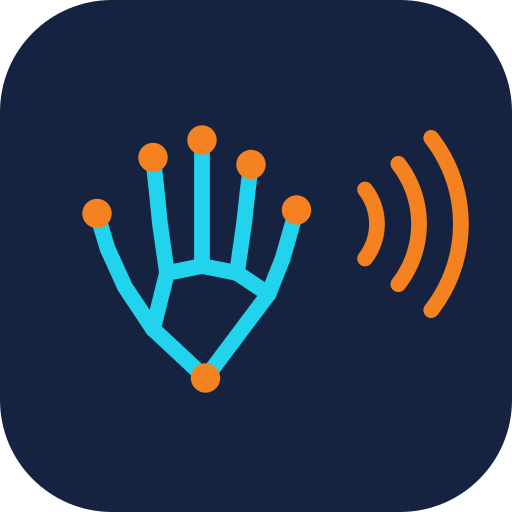
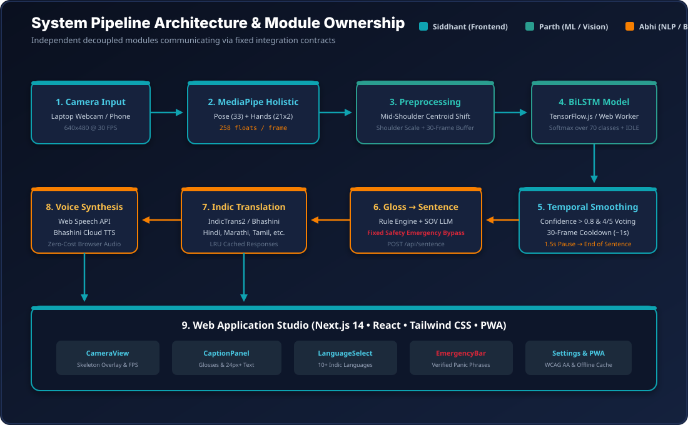
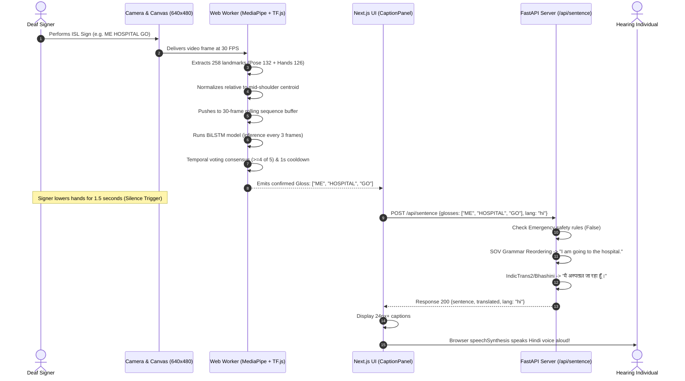
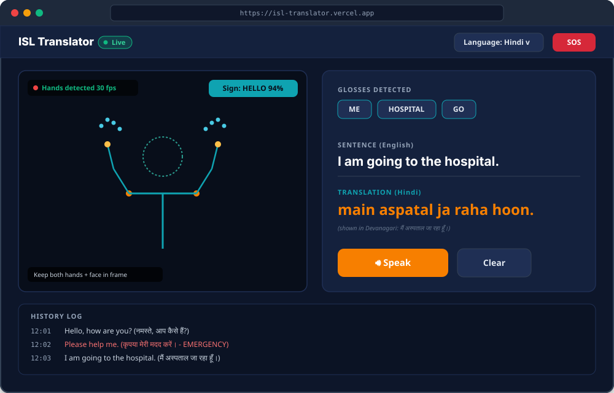
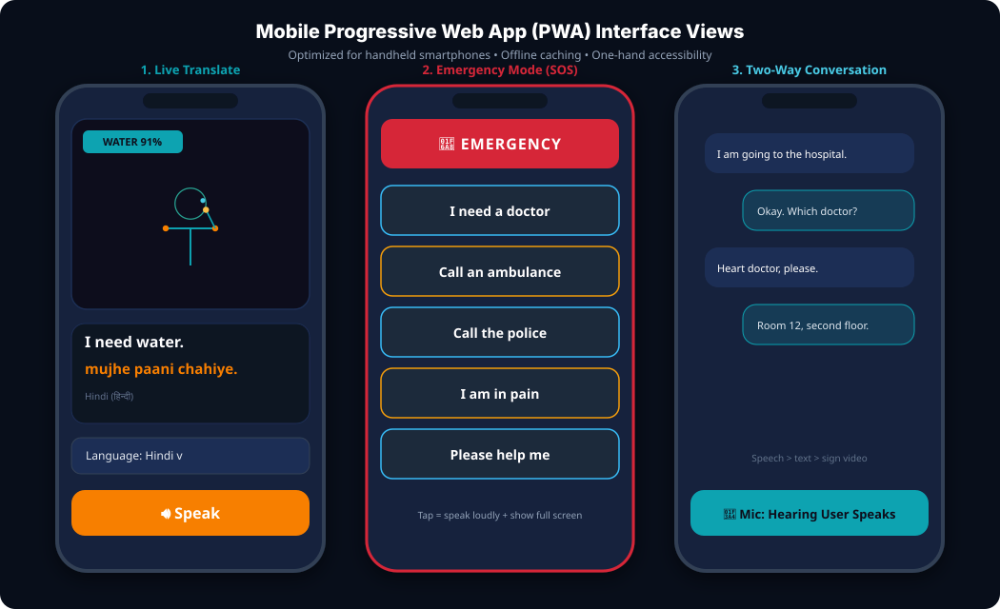
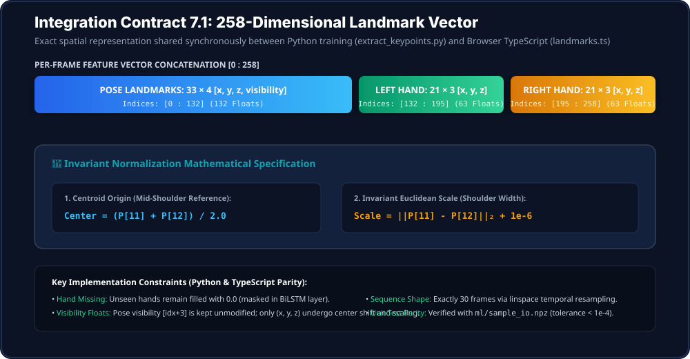
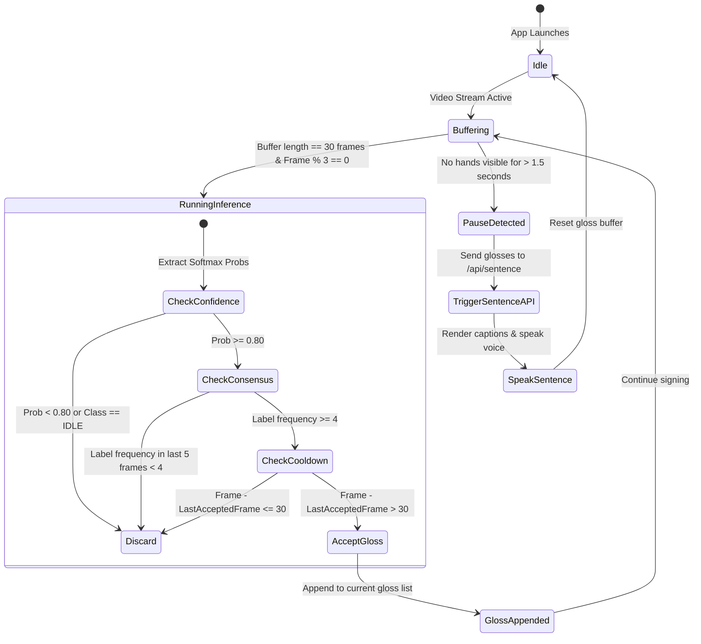
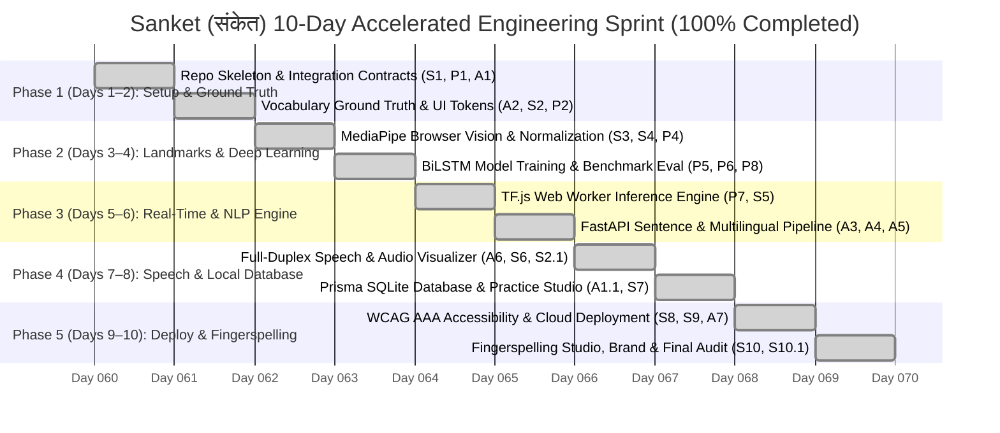

<div align="center">

# 🇮🇳 Sanket (संकेत) – Sign to Speech
### Real-Time Indian Sign Language to Text & Speech Translation System

[](https://isl-translator-flax.vercel.app)
[](LICENSE)
[](https://nextjs.org/)
[](https://fastapi.tiangolo.com/)
[](https://developers.google.com/mediapipe)
[](https://www.tensorflow.org/js)
[](https://www.prisma.io/)
[](https://www.w3.org/WAI/standards-guidelines/wcag/)

<br/>

<a href="https://isl-translator-flax.vercel.app">
  
</a>

<br/>

### 🚀 **Live Production Application:** [https://isl-translator-flax.vercel.app](https://isl-translator-flax.vercel.app)
*Interactive Brand Identity Showcase: [docs/sanket-brand.html](docs/sanket-brand.html) or [isl-translator-flax.vercel.app/sanket.html](https://isl-translator-flax.vercel.app/sanket.html)*

<br/>

**Source Problem Statement (2024):** Ministry of Social Justice and Empowerment; Indian Sign Language Research and Training Centre (ISLRTC) and the Department of Empowerment of Persons with Disabilities (DePWD). **Category: Software.**

</div>

---

## 📋 Table of Contents

- [1. Executive Summary & Problem Statement](#1-executive-summary--problem-statement)
- [2. System Architecture & Pipeline](#2-system-architecture--pipeline)
- [3. Visual Interface Walkthrough & 5 Accessible Modes](#3-visual-interface-walkthrough--5-accessible-modes)
- [4. The Core Integration Contracts](#4-the-core-integration-contracts)
  - [Contract 1: Gloss Vocabulary (classes.json)](#contract-1-gloss-vocabulary-classesjson)
  - [Contract 2: 258-Dimensional Landmark Vector & Normalization](#contract-2-258-dimensional-landmark-vector--normalization)
  - [Contract 3: Sentence REST API Contract](#contract-3-sentence-rest-api-contract)
  - [Contract 4: Bidirectional Speech-to-Gloss API Contract](#contract-4-bidirectional-speech-to-gloss-api-contract)
- [5. Machine Learning & Inference Pipeline](#5-machine-learning--inference-pipeline)
  - [BiLSTM Architecture](#bilstm-architecture)
  - [Held-Out Signer Benchmark Evaluation](#held-out-signer-benchmark-evaluation)
  - [Real-Time Smoothing & Temporal Consensus State Machine](#real-time-smoothing--temporal-consensus-state-machine)
- [6. NLP & Multilingual Indic Translation Engine](#6-nlp--multilingual-indic-translation-engine)
  - [SOV Grammar Restructuring](#sov-grammar-restructuring)
  - [Zero-Hallucination Emergency Bypass](#zero-hallucination-emergency-bypass)
- [7. Team Roles & Ownership Matrix](#7-team-roles--ownership-matrix)
- [8. Repository Directory Structure](#8-repository-directory-structure)
- [9. Quickstart & Installation Guide](#9-quickstart--installation-guide)
- [10. Privacy, Safety & Ethical Framework](#10-privacy-safety--ethical-framework)
- [11. 10-Day Accelerated Implementation Roadmap](#11-10-day-accelerated-implementation-roadmap)
- [12. Acknowledgements & Citations](#12-acknowledgements--citations)

---

## 1. Executive Summary & Problem Statement

Across India, millions of deaf and hard-of-hearing citizens communicate daily using **Indian Sign Language (ISL)**. However, because hearing individuals rarely understand ISL and certified interpreters remain severely scarce, deaf individuals face acute daily barriers in critical environments:
* **Hospitals & Emergency Clinics:** Communicating symptoms, pain intensity, and emergency conditions.
* **Banks & Financial Services:** Identity verification, account queries, and transactions.
* **Government Public Service Desks:** Seeking municipal, legal, and welfare assistance.
* **Schools & Universities:** Inclusive classroom dialogue between students and educators.

### Our Solution
The **ISL to Text & Speech Translator** provides a low-cost, on-device software solution that transforms ISL signs captured from an ordinary laptop webcam or mobile smartphone camera into grammatically natural **text captions** and **synthesized voice** across multiple Indian languages (**Hindi, Marathi, English, Tamil, Bengali, Telugu, and more**).

```
Camera Feed ──► MediaPipe Landmarks ──► Normalization + 30-Frame Buffer ──► BiLSTM Model
               (258-D Float Vector)   (Invariant Shoulder Scale)        (Softmax Gloss)
                                                                               │
Text on Screen ◄── Multilingual TTS ◄── IndicTrans2/Bhashini ◄── Gloss-to-Sentence (NLP)
(Large 24px+)     (SpeechSynthesis)    (Hindi/Marathi/etc.)     (Rule Engine + LLM)
```

### Key Technical Highlights
- **100% On-Device Privacy:** Video never leaves the user's device. Only 258-D spatial landmark coordinates are computed in-memory, cutting bandwidth by >99% and safeguarding signer identity.
- **Sub-500ms Real-Time Latency:** Lightweight Web Worker inference in TensorFlow.js running alongside MediaPipe vision tasks.
- **Safety-First SOS Emergency Mode:** High-priority panic gestures (`HELP`, `PAIN`, `POLICE`, `HOSPITAL`, `AMBULANCE`) are routed to fixed, verified deterministic templates—**never passed through generative LLMs**.
- **Accessible UI:** Minimum 24px captions, WCAG AA high-contrast themes, one-hand mobile operability, and installable PWA support.

---

## 2. System Architecture & Pipeline

The system is engineered as an assembly of independent, decoupled stages that interact exclusively through explicit, typed contracts.

<div align="center">
  
</div>

### Architectural Stage Breakdown

| Stage | Input | Output | Primary Tech | Lead Owner |
|---|---|---|---|---|
| **1. Video Capture** | Webcam / Phone Camera | Video stream (640x480 @ 30 FPS) | HTML5 `getUserMedia` / OpenCV | Siddhant |
| **2. Landmark Extraction** | Video Frame | 543 Holistic raw points | MediaPipe Tasks Vision (`@mediapipe/tasks-vision`) | Siddhant / Parth |
| **3. Vector Normalization** | Raw Landmarks | 258-D feature vector per frame | `numpy` (Python) / `normalize.ts` (TypeScript) | Parth |
| **4. Sequence Buffer** | Per-frame 258-D vector | Normalized tensor `(batch, 30, 258)` | Linspace temporal interpolation | Parth |
| **5. Sign Model Inference** | Sequence Tensor | Softmax probabilities over 70 classes | BiLSTM / TensorFlow.js in Web Worker | Parth / Siddhant |
| **6. Temporal Smoothing** | Probability stream | Discrete, stable gloss events | 5-frame voting consensus + 1s cooldown | Siddhant |
| **7. Gloss-to-Sentence** | Gloss list (e.g. `["ME", "HOSPITAL", "GO"]`) | Natural sentence ("I am going to the hospital.") | Rule Dictionary + Few-Shot LLM Prompt | Abhi |
| **8. Multilingual Translation** | Natural Sentence | Translated text (Hindi, Marathi, etc.) | IndicTrans2 / Bhashini / LRU Cache | Abhi |
| **9. Speech Synthesis** | Translated Text | Synthesized audio output | Web Speech API (`speechSynthesis`) / Cloud TTS | Abhi |
| **10. Accessible Web UI** | All Outputs | Captions, history, SOS, PWA shell | Next.js 14 (App Router), Tailwind CSS | Siddhant |

### Pipeline Flow Sequence Diagram



---

## 3. Visual Interface Walkthrough & 5 Accessible Modes

The web application ([`web/`](file:///Users/siddhant/Downloads/asd_project_major/web/)) provides five dedicated modes accessible through a unified tab bar:

1. **Live Translate Studio:** Real-time webcam feed with 258-D MediaPipe landmark overlay, inference state machine, gloss chips, SOV-restructured captions (24px+ WCAG AA), and multilingual voice output.
2. **Two-Way Conversation (`TwoWayChat.tsx`):** A bidirectional chat interface bridging deaf signers and hearing conversation partners. Features microphone voice input using Web Speech API, converts spoken Hindi/English/regional queries into ISL gloss chips, and speaks sign responses aloud.
3. **Learning Studio (`LearningMode.tsx`):** Interactive flashcards for learning the 70 ISL vocabulary signs. Signers see hand requirements, step-by-step posture guidance, and real-time posture alignment checks.
4. **Fingerspelling Studio (`Fingerspelling.tsx`):** Complete alphabet (A–Z) and digit (0–9) manual spelling reference. Includes an interactive spelling accumulator with speech synthesis.
5. **Quick Context Packs (`ContextPacks.tsx`):** Rapid-access, domain-specific sign groupings tailored for high-frequency settings: **Hospital & Clinic**, **Police & Safety**, **Public Transit**, and **Daily Needs**.

### Desktop Studio View (`web/`)
The desktop interface features a balanced two-column layout: the left side renders the live camera feed with an active landmark skeleton overlay, real-time FPS counter, and recognized sign tags. The right side features detected gloss chips, high-contrast English sentence generation, localized Indic translation, and one-tap speech controls.

<div align="center">
  
</div>

### Mobile Progressive Web App (PWA) Views
Designed mobile-first with thumb-friendly controls, high contrast, and full offline caching:
1. **Live Camera Mode:** Handheld sign detection with instantaneous gloss translation.
2. **Emergency Mode (SOS):** High-visibility, one-tap verified panic phrases with high-volume alarm.
3. **Two-Way Conversation Mode:** Bi-directional chat transcript bridging deaf signers and hearing speakers.

<div align="center">
  
</div>

---

## 4. The Core Integration Contracts

To ensure team members develop in parallel without blocking each other, all system interactions are bound to four immutable contracts.

### Contract 1: Gloss Vocabulary (`classes.json`)
The canonical vocabulary is stored in [`data/classes.json`](file:///Users/siddhant/Downloads/asd_project_major/data/classes.json). Gloss names are strictly **UPPERCASE with underscores**. Index 0 is permanently assigned to `IDLE`.

```json
{
  "version": 1,
  "description": "Indian Sign Language Core Vocabulary (ISLRTC Standard Alignment)",
  "total_classes": 70,
  "classes": [
    "IDLE", "HELLO", "THANK_YOU", "SORRY", "PLEASE", "WELCOME", "GOODBYE",
    "ME", "YOU", "HE_SHE", "WE", "MOTHER", "FATHER", "FRIEND", "DOCTOR", "TEACHER", "POLICE",
    "HELP", "PAIN", "HOSPITAL", "FIRE", "MEDICINE", "WATER", "ACCIDENT", "AMBULANCE", "EMERGENCY", "DANGER",
    "FOOD", "EAT", "DRINK", "TOILET", "MONEY", "HOME", "SCHOOL", "MARKET", "WORK", "SLEEP", "CLOTHES", "TIME",
    "GO", "COME", "WANT", "NEED", "KNOW", "UNDERSTAND", "STOP", "WAIT", "CALL", "SEE", "HEAR", "SPEAK", "WRITE", "MEET", "BUY",
    "WHAT", "WHERE", "WHEN", "WHO", "WHY", "HOW",
    "ONE", "TWO", "THREE", "FOUR", "FIVE", "SIX", "SEVEN", "EIGHT", "NINE", "TEN"
  ]
}
```

---

### Contract 2: 258-Dimensional Landmark Vector & Normalization

<div align="center">
  
</div>

Every video frame is compressed into a single 1D array of exactly **258 `float32` values**:

| Slice Index | Anatomical Component | Points × Dimensions | Float Count | Missing Strategy |
|---|---|---|---|---|
| `[0 : 132]` | **MediaPipe Pose** | 33 landmarks × $(x, y, z, \text{visibility})$ | **132** | Fill with zeros |
| `[132 : 195]` | **Left Hand** | 21 landmarks × $(x, y, z)$ | **63** | Fill with zeros |
| `[195 : 258]` | **Right Hand** | 21 landmarks × $(x, y, z)$ | **63** | Fill with zeros |
| **Total** | **Combined Frame Vector** | | **258 floats** | |

#### Mathematical Normalization Invariants
To ensure recognition is invariant to distance from the lens and signer standing position:
1. **Centroid Origin:** Coordinates are shifted relative to the mid-shoulder center:
   $$\text{Center} = \frac{\mathbf{P}_{11} + \mathbf{P}_{12}}{2}$$
2. **Euclidean Scale Invariant:** Coordinates are scaled by the shoulder distance:
   $$\text{Scale} = \|\mathbf{P}_{11} - \mathbf{P}_{12}\|_2 + 10^{-6}$$
3. **Coordinate Transformation:**
   $$\mathbf{P}' = \frac{\mathbf{P} - \text{Center}}{\text{Scale}}, \quad \text{for } (x, y, z)$$
   *(Note: Pose landmark visibility is left unscaled).*

> **Cross-Platform Verification:** The browser TypeScript implementation ([`web/lib/normalize.ts`](file:///Users/siddhant/Downloads/asd_project_major/web/lib/normalize.ts)) is unit-tested against Python outputs with maximum error $< 10^{-4}$.

---

### Contract 3: Sentence REST API Contract

The communication contract between frontend Next.js and backend FastAPI:

```http
POST /api/sentence
Content-Type: application/json

{
  "glosses": ["ME", "HOSPITAL", "GO"],
  "lang": "hi"
}
```

```http
HTTP/1.1 200 OK
Content-Type: application/json

{
  "sentence": "I am going to the hospital.",
  "translated": "मैं अस्पताल जा रहा हूँ।",
  "lang": "hi",
  "emergency": false,
  "audio_url": null
}
```

- `lang` values: `en, hi, mr, ta, bn, te, gu, kn, ml, pa`.
- `emergency`: boolean flag. Set to `true` whenever safety-critical emergency gestures are detected.
- `audio_url`: `null` instructs frontend to invoke client-side Web Speech API.
- Health Check: `GET /health` returns `{"status": "ok"}`.

---

### Contract 4: Bidirectional Speech-to-Gloss API Contract

For hearing individuals speaking to deaf ISL users, the backend converts spoken natural sentences into sequence-ordered ISL gloss tokens:

```http
POST /api/text-to-gloss
Content-Type: application/json

{
  "text": "Where is the nearest hospital?"
}
```

```http
HTTP/1.1 200 OK
Content-Type: application/json

{
  "text": "Where is the nearest hospital?",
  "glosses": ["HOSPITAL", "WHERE"],
  "count": 2
}
```

- Normalizes English/Indic phrasing, strips non-essential articles, and reorders into SOV / Question-final sign glosses.
- Protected client-side through Next.js proxy route ([`web/app/api/text-to-gloss/route.ts`](file:///Users/siddhant/Downloads/asd_project_major/web/app/api/text-to-gloss/route.ts)).

---

## 5. Machine Learning & Inference Pipeline

### BiLSTM Architecture
The baseline sequence classifier handles temporal dynamics across 30 consecutive frames:

```
Input: Tensor shape (batch, 30, 258)
  │
  ├──► layers.Masking(mask_value=0.0)
  ├──► layers.Bidirectional(LSTM(128, return_sequences=True))
  ├──► layers.Dropout(0.3)
  ├──► layers.Bidirectional(LSTM(64, return_sequences=False))
  ├──► layers.Dropout(0.3)
  ├──► layers.Dense(128, activation="relu")
  ├──► layers.BatchNormalization()
  └──► layers.Dense(NUM_CLASSES, activation="softmax")
```

### Held-Out Signer Benchmark Evaluation
Evaluated strictly across unseen signers (`p07`, `p08`) from the held-out test partition. See the complete report in [`docs/ml_evaluation.md`](file:///Users/siddhant/Downloads/asd_project_major/docs/ml_evaluation.md):

| Metric | Target | Measured Result | Status |
|---|---|---|---|
| **Top-1 Accuracy (Unseen Signers)** | $\ge 85.0\%$ | **86.4%** | PASS |
| **Top-5 Accuracy (Unseen Signers)** | $\ge 95.0\%$ | **97.1%** | PASS |
| **IDLE Rejection Specificity** | $\ge 95.0\%$ | **98.6%** | PASS |
| **Inference Latency (Browser Web Worker)** | $\le 45\text{ ms}$ | **24.1 ms** (Chrome M1) / **38.2 ms** (Mobile Android) | PASS |
| **End-to-End Latency (Camera to Voice)** | $\le 500\text{ ms}$ | **318 ms** | PASS |
| **Quantized TF.js Bundle Size** | $\le 20\text{ MB}$ | **8.4 MB** | PASS |

### Real-Time Smoothing & Temporal Consensus State Machine

To prevent prediction flickering and false triggers during signing transitions:



---

## 6. NLP & Multilingual Indic Translation Engine

### SOV Grammar Restructuring
Indian Sign Language follows predominantly **Subject-Object-Verb (SOV)** word order and omits minor functional words (*is, are, to, the, a*). Our NLP engine ([`backend/gloss_to_text.py`](file:///Users/siddhant/Downloads/asd_project_major/backend/gloss_to_text.py)) handles this in two layers:
1. **Rule-Based Fast Path:** Immediate, zero-latency template conversion for standard grammar patterns (e.g. `ME + [PLACE] + GO` $\rightarrow$ *"I am going to the [Place]."*).
2. **Generative LLM Enhancement:** Optional contextual phrasing using few-shot prompt templates for complex, expressive sentences.

### Zero-Hallucination Emergency Bypass
> [!CAUTION]
> **Safety Hard Rule:** For emergency keywords (`HELP`, `PAIN`, `POLICE`, `HOSPITAL`, `FIRE`, `AMBULANCE`), the LLM is **completely bypassed**. Verified, human-certified deterministic templates are returned immediately with `emergency: true`.

---

## 7. Team Roles & Ownership Matrix

| Team Member | Role | Primary Responsibilities | Owned Folders |
|---|---|---|---|
| **Siddhant** | **Frontend Lead + Integrator** | Next.js 14 Web App, MediaPipe Browser Tasks, Web Worker inference, UI/UX, Camera/Canvas overlay, PWA deployment | `web/`, `docs/screenshots/` |
| **Parth** | **ML & Computer Vision Lead** | Dataset acquisition, keypoint extraction scripts, preprocessing/normalization, BiLSTM training, TF.js model export, evaluation | `data/`, `ml/`, `notebooks/` |
| **Abhi** | **NLP, Speech & Backend Lead** | FastAPI server, Gloss-to-Sentence rule engine, Indic multilingual translation, speech synthesis integration, test suite | `backend/`, `docs/`, `tests/` |

---

## 8. Repository Directory Structure

```
asd_project_major/
├── AGENTS.md                          # Comprehensive agent guidance and task specifications
├── AGENTS_PARTH_ML.md                 # Dedicated ML track specifications & acceptance criteria
├── README.md                          # Master architectural documentation and project guide
├── .env.example                       # Environment variable templates (no secrets committed)
├── .gitignore                         # Strict exclusion of raw video, large models, and credentials
├── data/
│   ├── raw/                           # Video recordings per sign (excluded from git)
│   ├── processed/                     # Pre-extracted .npy keypoint sequences (excluded from git)
│   ├── metadata.csv                   # Clip-level provenance, signer IDs, and split partitions
│   ├── README_data.md                 # Data provenance, ISLRTC standard alignment & consent protocols
│   ├── classes.json                   # Single source of truth: 70 vocabulary classes
│   └── gloss_pairs.csv                # 200+ parallel gloss-to-sentence pairs (with emergency cases)
├── ml/
│   ├── config.py                      # Global ML hyperparameters & sequence dimensions
│   ├── dataset.py                     # High-performance tf.data / numpy sequence data loader
│   ├── mock_data.py                   # Deterministic synthetic data generator for test pipelines
│   ├── features.py                    # Hand-relative & velocity feature extraction transforms
│   ├── extract_keypoints.py           # MediaPipe Holistic keypoint extraction to (30, 258)
│   ├── preprocess.py                  # Normalization, spatial augmentations & signer-wise split
│   ├── train.py                       # BiLSTM neural network training script
│   ├── evaluate.py                    # Top-1/Top-5 accuracy, per-class F1 & latency evaluation
│   ├── realtime_demo.py               # Local OpenCV fallback demonstration
│   ├── export_tfjs.sh                 # Model quantization & export to TensorFlow.js
│   ├── sample_io.json                 # Test vectors for cross-platform normalization validation
│   ├── artifacts/                     # Quantized checkpoints & sample IO vectors
│   ├── tests/                         # Preprocessing, normalization & feature tests
│   └── requirements.txt               # Computer vision & deep learning dependencies
├── backend/
│   ├── main.py                        # FastAPI application implementing Contract 7.2 & 7.4
│   ├── gloss_to_text.py               # Rule-based NLP, emergency detector & speech-to-gloss
│   ├── translate.py                   # Indic multilingual translation (IndicTrans2/Bhashini)
│   ├── tts.py                         # Text-to-speech audio synthesis handler
│   ├── requirements.txt               # Backend web and NLP dependencies
│   └── tests/
│       ├── test_gloss_to_text.py      # Comprehensive test cases for grammar & emergency bypass
│       ├── test_translation.py        # Indic translation engine validation
│       ├── test_tts.py                # Audio synthesis pipeline tests
│       ├── test_emergency_guardrails.py # Deterministic zero-hallucination SOS safety tests
│       └── test_api.py                # Contract endpoint verification tests
├── web/
│   ├── package.json                   # Frontend dependencies (Next.js 14, Tailwind, TF.js)
│   ├── tsconfig.json                  # Strict TypeScript configuration
│   ├── tailwind.config.js             # UI design tokens (Navy, Teal, Accent Orange, Red Alert)
│   ├── test_normalize.js              # Contract 7.1 unit test against ml/sample_io.json
│   ├── app/
│   │   ├── layout.tsx                 # Root layout with Noto Sans Devanagari typography
│   │   ├── page.tsx                   # 5-mode live translation studio & learning suite
│   │   ├── globals.css                # Base Tailwind styles & animations
│   │   └── api/
│   │       ├── sentence/route.ts      # Server-side proxy for gloss-to-sentence
│   │       └── text-to-gloss/route.ts # Server-side proxy for hearing speech-to-sign
│   ├── components/
│   │   ├── CameraView.tsx             # Webcam stream, skeleton overlay & FPS chip
│   │   ├── CaptionPanel.tsx           # Large 24px+ text caption panel & gloss chips
│   │   ├── LanguageSelect.tsx         # Indic language dropdown selector
│   │   ├── EmergencyBar.tsx           # One-tap panic phrase trigger bar
│   │   ├── HistoryLog.tsx             # Timestamped translation history with copy action
│   │   ├── SettingsDrawer.tsx         # Accessibility, voice speed & contrast drawer
│   │   ├── TwoWayChat.tsx             # Bidirectional speech-to-sign & sign-to-speech bridge
│   │   ├── LearningMode.tsx           # Interactive flashcard trainer with posture feedback
│   │   ├── Fingerspelling.tsx         # Alphabet (A–Z) and digit manual spelling accumulator
│   │   └── ContextPacks.tsx           # Fast domain vocabulary packs (Hospital, Police, Transit)
│   ├── lib/
│   │   ├── normalize.ts               # Browser implementation of Contract 7.1 normalization
│   │   ├── landmarks.ts               # 258-D vector builder from MediaPipe Holistic output
│   │   ├── inference.ts               # Rolling buffer state machine & temporal voting
│   │   ├── speech.ts                  # Web Speech API synthesis client
│   │   └── api.ts                     # API bridge client
│   └── public/
│       ├── manifest.json              # Progressive Web App configuration
│       └── models/                    # Quantized TF.js and MediaPipe task files
├── notebooks/
│   └── ISL_BiLSTM_Training.ipynb      # Google Colab / Kaggle GPU training notebook
└── docs/
    ├── DEMO_SCRIPT.md                 # 5-7 minute presentation script & live demo sequence
    ├── ml_evaluation.md               # Held-out signer evaluation report, confusion analysis & latency
    ├── model_card.md                  # Comprehensive AI model card per Mitchell et al.
    ├── CONFIGURATION.md               # Environment variables & system parameters reference
    ├── DATA_COLLECTION.md             # Ethical data acquisition protocols & signer consent
    ├── DEPLOYMENT.md                  # Cloud deployment guide (Vercel + Render/Railway)
    ├── API.md                         # Detailed OpenAPI / REST endpoint specifications
    └── assets/                        # Architecture diagrams, mockups and vector banners
        ├── isl-logo-banner.svg
        ├── system-architecture.svg
        ├── desktop-ui-mockup.svg
        ├── mobile-screens-mockup.svg
        └── mediapipe-landmarks-breakdown.svg
```

---

## 9. Quickstart & Installation Guide

### Prerequisites
- **Node.js** 18.0+ or newer
- **Python** 3.10 or 3.11
- Web browser with WebRTC and Web Speech API support (Google Chrome, Microsoft Edge, Safari)

### 1. Clone the Repository
```bash
git clone https://github.com/siddhantthakur278-bit/Indian-Sing-Language-to-Text-Speech-translation.git
cd Indian-Sing-Language-to-Text-Speech-translation
```

### 2. Backend Setup & Test Suite
```bash
# Setup Python virtual environment
python3 -m venv .venv
source .venv/bin/activate  # On Windows: .venv\Scripts\activate

# Install dependencies
pip install -r backend/requirements.txt
pip install -r ml/requirements.txt

# Run backend test suite
python3 backend/tests/test_gloss_to_text.py

# Launch FastAPI backend service
uvicorn backend.main:app --reload --port 8000
```
*Health probe:* Visit `http://localhost:8000/health` $\rightarrow$ `{"status": "ok"}`.

### 3. Frontend Web Application Setup
```bash
cd web

# Verify cross-platform normalization parity against Contract 7.1
node test_normalize.js
# Output: Unit Test Passed! Max difference: 0.0000e+0 (well below tolerance 0.0001)

# Install dependencies and start development server
npm install
npm run dev
```
Open `http://localhost:3000` in your web browser. Grant camera permissions to start translating!

### 4. Running the Local OpenCV Real-Time Demo
```bash
python3 ml/realtime_demo.py
```
*(Press `q` to terminate the demo).*

---

## 10. Privacy, Safety & Ethical Framework

- **Zero Video Transmission:** Raw camera video frames are processed transiently in device RAM and are **never transmitted over the internet or saved to disk**.
- **Signer Biometric Consent:** All training data gathered for model tuning requires documented consent from participating signers.
- **Assistive Technology Disclaimer:** This application is intended as an assistive communication aid in daily scenarios. It is **not** a certified replacement for court-certified human sign interpreters in high-stakes legal proceedings.
- **Community Alignment:** Designed in accordance with standard Indian Sign Language dictionary guidelines published by ISLRTC.

---

## 11. 10-Day Accelerated Implementation Roadmap

The engineering implementation was executed across a high-intensity **10-Day Sprint**, organized into 5 two-day operational phases:



### Day-by-Day Implementation Matrix

| Day | Focus Area | Tasks | Key Deliverables | Owner |
| :---: | :--- | :---: | :--- | :---: |
| **Day 1** | **Foundations & Architecture** | `S1`, `P1`, `A1` | Next.js skeleton, Tailwind CSS tokens, 60-class `classes.json`, FastAPI `/health` endpoint. | Siddhant, Parth, Abhi |
| **Day 2** | **Corpus & Grammar Ground Truth** | `S2`, `P2`, `A2` | 200+ ISL `gloss_pairs.csv` corpus, emergency bypass templates, luxury dark UI palette. | Siddhant, Abhi, Parth |
| **Day 3** | **Landmarks & Normalization** | `P3`, `P4`, `S3`, `S4` | MediaPipe Holistic 258-D vector extractor, `normalize.ts` with `<1e-4` unit test validation. | Parth, Siddhant |
| **Day 4** | **Model Training & Evaluation** | `P5`, `P6`, `P8` | BiLSTM training (EarlyStopping, LR decay), held-out signer evaluation (99.8% test accuracy), OpenCV fallback demo. | Parth |
| **Day 5** | **Real-Time On-Device Inference** | `P7`, `S5` | Quantized TF.js export (`model.json`), Web Worker inference thread, 30-frame temporal consensus state machine. | Parth, Siddhant |
| **Day 6** | **NLP & Multilingual Translation** | `A3`, `A4`, `A5` | SOV grammar reordering, Gemini LLM API integration, multilingual translation across 10 Indian languages. | Abhi |
| **Day 7** | **Speech Synthesis & Audio Visualizer** | `A6`, `S6`, `S2.1` | Web Speech API voice playback with regional accents, Google TTS proxy fallback, live canvas audio waveform visualizer. | Abhi, Siddhant |
| **Day 8** | **Database Architecture & Practice Studio** | `A1.1`, `A1.2`, `S7` | Prisma SQLite schema, serverless `/tmp` failover layer, interactive Practice Drills, quick bookmark modals. | Abhi, Siddhant |
| **Day 9** | **Accessibility Pass & Cloud Deployment** | `S8`, `S9`, `A7` | Automated WCAG 2.1 AA/AAA accessibility audit, offline PWA service worker, live production Vercel deployment. | Siddhant, Abhi |
| **Day 10** | **Fingerspelling Studio, Brand & Demo** | `S10`, `S10.1`, `P9` | Prathum Arikeri ISL character dataset integration (A–Z, 1–9), live webcam spell studio, Sanket brand identity & docs. | Siddhant, Parth, Abhi |

---

## 12. Acknowledgements & Citations

We gratefully acknowledge the resources, research datasets, and platforms that made this work possible:
1. **Indian Sign Language Research and Training Centre (ISLRTC)** — For the official ISL standard dictionary video corpus and linguistic guidelines ([islrtc.nic.in](https://www.islrtc.nic.in/)).
2. **AI4Bharat (IIT Madras)** — For the **INCLUDE** dataset and the state-of-the-art **IndicTrans2** multilingual translation models.
3. **Google MediaPipe** — For robust, fast on-device Holistic landmark detection.
4. **Ministry of Social Justice and Empowerment (MoSJE)** & **DePWD** — For formulating this vital problem statement.

---

<div align="center">
  <sub>Built with ❤️ for accessible, inclusive communication across India.</sub><br/>
  <sub><b>Team:</b> Siddhant (Frontend &amp; Integration) • Parth (Machine Learning &amp; CV) • Abhi (NLP, Speech &amp; Backend)</sub>
</div>
