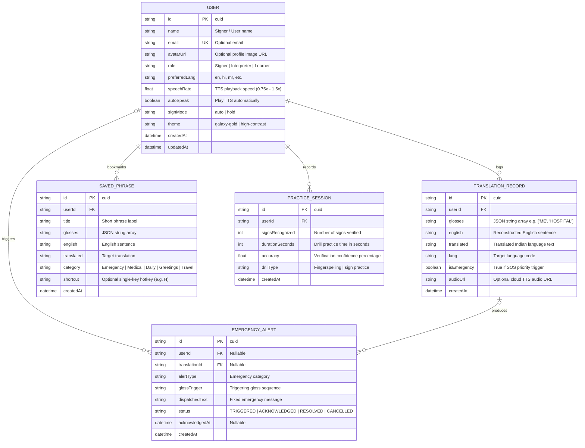

# ISL Translator: Prisma Database Architecture

## 1. Overview
The database layer is managed using **Prisma ORM** (`v5.22.0`) with **SQLite** (`dev.db`). It provides lightweight, reliable, zero-config local persistence ensuring that:
1. All video and landmark tracking remains **100% on-device** (never uploaded to any server or cloud).
2. Users can customize their assistive profiles, bookmark critical communication phrases, review translation history, and track practice session progress offline.

---

## 2. Entity-Relationship Diagram



---

## 3. Database Management & Seeding Commands

### A. Local SQLite (Prisma ORM)
```bash
# Push schema changes to SQLite dev.db
npx prisma db push

# Generate Prisma Client
npx prisma generate

# Seed initial default user and curated emergency phrases
npm run db:seed

# Inspect database visually with Prisma Studio
npx prisma studio
```

### B. Production PostgreSQL via `psql` CLI
For centralized persistence on cloud providers (Render Postgres, Supabase, Neon):

```bash
# 1. Create database
psql -U postgres -d postgres -c "CREATE DATABASE isl_translator;"

# 2. Apply complete DDL schema, types, indexes, and triggers
psql -U postgres -d isl_translator -f database/schema.sql

# 3. Seed data and run query suite
psql -U postgres -d isl_translator -f database/queries.sql
```

See [database/README.md](file:///Users/siddhant/Downloads/asd_project_major/database/README.md) and [database/queries.sql](file:///Users/siddhant/Downloads/asd_project_major/database/queries.sql) for the complete psql query suite.
