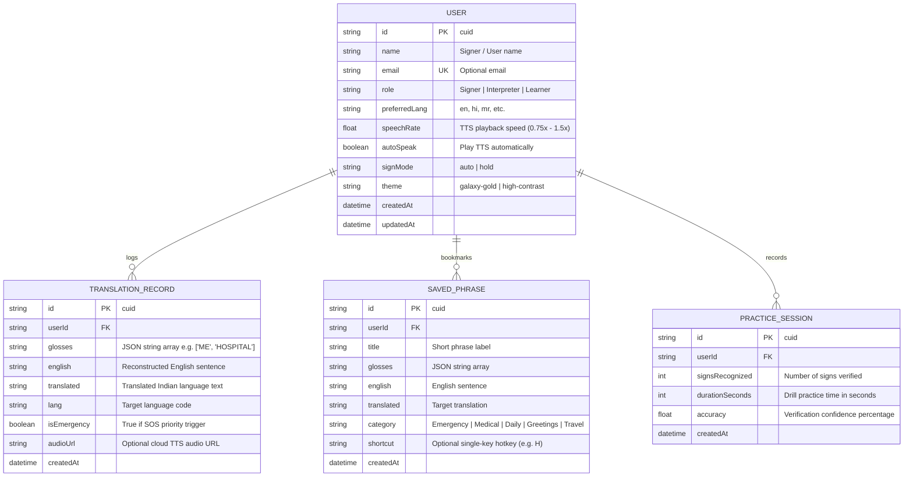

# ISL Translator: Prisma Database Architecture

## 1. Overview
The database layer is managed using **Prisma ORM** (`v5.22.0`) with **SQLite** (`dev.db`). It provides lightweight, reliable, zero-config local persistence ensuring that:
1. All video and landmark tracking remains **100% on-device** (never uploaded to any server or cloud).
2. Users can customize their assistive profiles, bookmark critical communication phrases, review translation history, and track practice session progress offline.

---

## 2. Entity-Relationship Diagram



---

## 3. Database Management & Seeding Commands

```bash
# Push schema changes to SQLite dev.db
npx prisma db push

# Generate Prisma Client
npx prisma generate

# Seed initial default user and curated emergency phrases
npm run db:seed

# Inspect database visually with Prisma Studio
npx prisma studio
```
