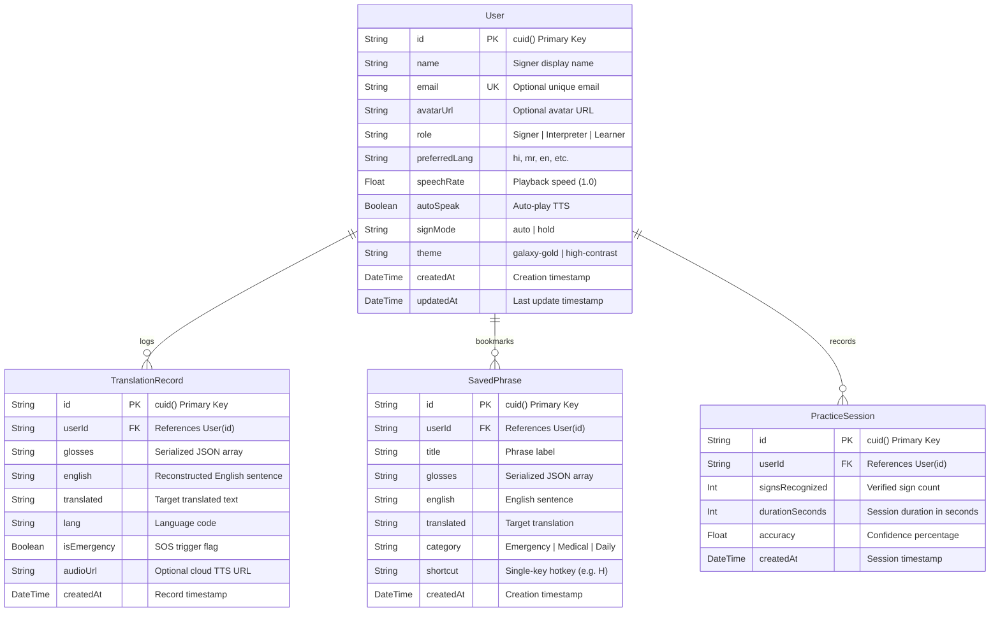
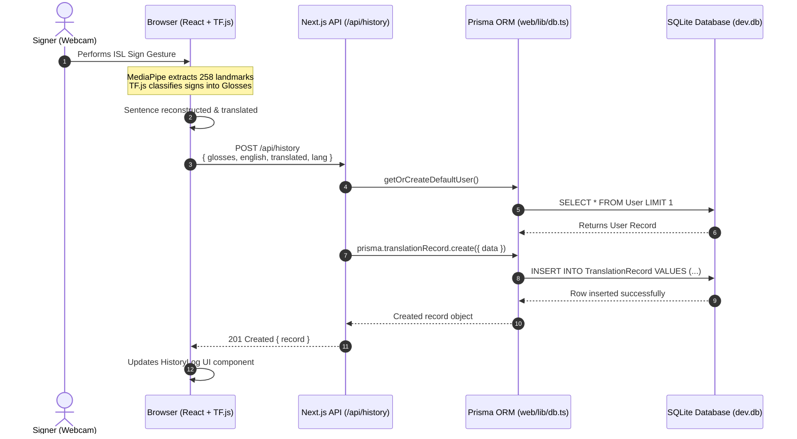

# Database Architecture and Technical Documentation

> **Project:** Indian Sign Language (ISL) to Text and Speech Real-Time Translator  
> **Component:** Relational Data Persistence Layer  
> **Prepared For:** Advanced System Design (ASD) Viva, Project Demonstration, and Architecture Review  
> **Specification Standard:** Fully grounded in repository implementation (`web/prisma/schema.prisma`, `web/lib/db.ts`, and Next.js server-side route handlers).

---

## Table of Contents
1. [Project Database Overview](#1-project-database-overview)
2. [Database Technology and ORM](#2-database-technology-and-orm)
3. [Database Architecture](#3-database-architecture)
4. [Database Schema](#4-database-schema)
5. [Tables and Models](#5-tables-and-models)
6. [Fields and Data Types](#6-fields-and-data-types)
7. [Primary Keys and Foreign Keys](#7-primary-keys-and-foreign-keys)
8. [Entity Relationships](#8-entity-relationships)
9. [ER Diagram using Mermaid](#9-er-diagram-using-mermaid)
10. [Database Connection and Configuration](#10-database-connection-and-configuration)
11. [Database Initialization and Seeding](#11-database-initialization-and-seeding)
12. [CRUD Operations](#12-crud-operations)
13. [API Endpoints Connected to the Database](#13-api-endpoints-connected-to-the-database)
14. [Data Flow](#14-data-flow)
15. [Database Security and Data Privacy](#15-database-security-and-data-privacy)
16. [Important Design Decisions](#16-important-design-decisions)

---

## 1. Project Database Overview

The **Indian Sign Language (ISL) to Text and Speech Real-Time Translator** is an assistive communication system built for Deaf and Hard-of-Hearing individuals. It captures real-time video feeds from a standard webcam, extracts 258 MediaPipe Holistic landmarks (pose and hands) **locally on the user's device**, predicts sign glosses via an on-device TensorFlow.js model in a Web Worker, and translates them into natural Indian language text and synthesized speech.

### Role of the Database in the System
The database layer functions as an **offline-first local persistence engine**. It does not participate in computer vision, frame processing, or AI model execution. Instead, it fulfills four critical assistive application requirements:

1. **User Profile & Accessibility Customization:** Persists user preferences such as target language (`preferredLang`), speech playback rate (`speechRate`), automatic voice playback (`autoSpeak`), sign detection mode (`signMode`), and high-contrast UI themes (`theme`).
2. **Translation History Audit Log:** Automatically archives recognized sign glosses, reconstructed English sentences, translated Indian text, timestamps, and emergency priority flags into `TranslationRecord`.
3. **Curated Quick-Access Bookmarks:** Stores critical communication phrases (`SavedPhrase`) categorized into Emergency, Medical, Daily, Greetings, and Travel, with single-key keyboard hotkeys for instant emergency activation.
4. **Gamified Practice Tracking:** Logs drill sessions, sign count achievements, drill durations, and recognition accuracy percentages (`PracticeSession`) for learners practicing sign gestures.

### Zero-Biometric Privacy Guarantee
In accordance with Section 9 of the project engineering specification (`AGENTS.md`), **video frames and biometric landmark coordinates are strictly ephemeral and are never stored in the database or transmitted over the network**. The database exclusively persists text-based metadata and numerical analytics.

---

## 2. Database Technology and ORM

| Layer | Technology | Version | Purpose in Project |
|---|---|---|---|
| **Database Engine** | **SQLite** (`dev.db`) | 3.x (via Prisma engine) | Embedded, zero-configuration, single-file relational database storage. |
| **ORM** | **Prisma ORM** | `^5.22.0` | Schema declaration, automated migrations, type-safe query generation, and Prisma Client. |
| **Client Driver** | `@prisma/client` | `^5.22.0` | Node.js / TypeScript query client used across Next.js API route handlers. |
| **GUI Inspector** | **Prisma Studio** | `5.22.0` | Browser-based administrative console for manual inspection and verification. |

### Technical Justification
* **Embedded RDBMS:** SQLite does not require a standalone daemon process, socket listening, user permission grants, or external cloud infrastructure. The database is contained entirely within a local file (`dev.db`).
* **End-to-End Type Safety:** Prisma automatically generates TypeScript types directly from the schema file (`web/prisma/schema.prisma`). Any changes to model definitions immediately trigger compile-time type verification across all Next.js API routes.
* **Separation of Concerns:** 
  - The **Next.js Web Server** (`web/`) owns and executes all database operations.
  - The **FastAPI Backend** (`backend/`) is purely stateless with respect to databases; it handles NLP translation, rule resolution, and in-memory caching (`ResponseCache` in `backend/cache.py`).

---

## 3. Database Architecture

The application adopts a **Client-Server-Embedded** data architecture:

```
┌────────────────────────────────────────────────────────────────────────┐
│                        BROWSER / CLIENT UI                             │
│  - Webcam Video Feed (getUserMedia)                                    │
│  - MediaPipe Vision Landmark Extraction (258 coordinates)              │
│  - TensorFlow.js Inference Worker (Predicts Glosses on-device)         │
│  - Web Speech API (Client-side speech synthesis)                       │
└───────────────────────────────────┬────────────────────────────────────┘
                                    │ HTTP REST (JSON)
                                    ▼
┌────────────────────────────────────────────────────────────────────────┐
│                     NEXT.JS WEB APPLICATION SERVER                     │
│  - API Routes: /api/user, /api/history, /api/saved-phrases, /api/practice│
│  - Route Validation, Error Handling & Fallback Orchestration           │
├────────────────────────────────────────────────────────────────────────┤
│                       PRISMA ORM (web/lib/db.ts)                       │
│  - Global Singleton PrismaClient Instance                              │
│  - Vercel Serverless File Dynamic Relocation (/tmp/dev.db)            │
│  - In-memory Static Fallback Arrays (Fault Tolerance)                  │
└───────────────────────────────────┬────────────────────────────────────┘
                                    │ Local Disk I/O (file:./dev.db)
                                    ▼
┌────────────────────────────────────────────────────────────────────────┐
│                    SQLITE RELATIONAL STORAGE (dev.db)                  │
│                                                                        │
│   ┌────────┐       1:N       ┌───────────────────┐                     │
│   │  User  │─────────────────▶│ TranslationRecord │                     │
│   └────┬───┘                 └───────────────────┘                     │
│        │                                                               │
│        │ 1:N                 ┌───────────────────┐                     │
│        ├────────────────────▶│    SavedPhrase    │                     │
│        │                     └───────────────────┘                     │
│        │ 1:N                 ┌───────────────────┐                     │
│        └────────────────────▶│  PracticeSession  │                     │
│                              └───────────────────┘                     │
└────────────────────────────────────────────────────────────────────────┘
```

### Connection Management and Lifecycle (`web/lib/db.ts`)
To prevent connection exhaustion and memory leaks during Next.js Hot Module Replacement (HMR) in development mode, the Prisma client is bound to the Node.js global object using the **Global Singleton Pattern**:

```typescript
// web/lib/db.ts
const globalForPrisma = global as unknown as { prisma: PrismaClient };

export const prisma =
  globalForPrisma.prisma ||
  new PrismaClient({
    datasources: {
      db: { url: dbUrl },
    },
    log: process.env.NODE_ENV === "development" ? ["warn", "error"] : ["error"],
  });

if (process.env.NODE_ENV !== "production") globalForPrisma.prisma = prisma;
```

---

## 4. Database Schema

The declarative schema is defined in `web/prisma/schema.prisma`:

```prisma
datasource db {
  provider = "sqlite"
  url      = env("DATABASE_URL")
}

generator client {
  provider = "prisma-client-js"
}

model User {
  id             String              @id @default(cuid())
  name           String              @default("Siddhant")
  email          String?             @unique
  avatarUrl      String?
  role           String              @default("Signer") // "Signer" | "Interpreter" | "Learner"
  preferredLang  String              @default("hi")
  speechRate     Float               @default(1.0)
  autoSpeak      Boolean             @default(true)
  signMode       String              @default("auto") // "auto" | "hold"
  theme          String              @default("galaxy-gold")
  createdAt      DateTime            @default(now())
  updatedAt      DateTime            @updatedAt
  translations   TranslationRecord[]
  savedPhrases   SavedPhrase[]
  sessions       PracticeSession[]
}

model TranslationRecord {
  id          String   @id @default(cuid())
  userId      String?
  user        User?    @relation(fields: [userId], references: [id], onDelete: Cascade)
  glosses     String   // Stored as JSON string array e.g. '["HELLO","FRIEND"]'
  english     String
  translated  String
  lang        String
  isEmergency Boolean  @default(false)
  audioUrl    String?
  createdAt   DateTime @default(now())
}

model SavedPhrase {
  id         String   @id @default(cuid())
  userId     String?
  user       User?    @relation(fields: [userId], references: [id], onDelete: Cascade)
  title      String
  glosses    String   // JSON string array e.g. '["ME","WATER","WANT"]'
  english    String
  translated String
  category   String   @default("General") // "Emergency", "Medical", "Greetings", "Daily"
  shortcut   String?
  createdAt  DateTime @default(now())
}

model PracticeSession {
  id              String   @id @default(cuid())
  userId          String?
  user            User?    @relation(fields: [userId], references: [id], onDelete: Cascade)
  signsRecognized Int      @default(0)
  durationSeconds Int      @default(0)
  accuracy        Float    @default(0.0)
  createdAt       DateTime @default(now())
}
```

---

## 5. Tables and Models

The database contains **four core relational models**:

1. **`User` Table:**  
   The primary parent entity. Stores user identity, assistive role, preferred target language, TTS voice playback rate, and application theme.
2. **`TranslationRecord` Table:**  
   An append-only log of every completed sign translation. Stores recognized glosses, English sentence reconstruction, translated target text, language code, and an emergency status flag.
3. **`SavedPhrase` Table:**  
   Stores bookmarked phrases for rapid assistive communication. Includes short phrases, categorization (Emergency, Medical, Greetings, Daily, Travel), and single-character keyboard shortcuts.
4. **`PracticeSession` Table:**  
   Records user training sessions in the interactive learning studio. Tracks verified sign count, drill duration, and average model confidence.

---

## 6. Fields and Data Types

### 6.1 `User` Model
| Field Name | Prisma Type | SQLite Storage | Nullable | Default Value | Description / Constraints |
|---|---|---|---|---|---|
| `id` | `String` | `TEXT` | No | `cuid()` | Primary Key (Collision-Resistant Unique Identifier) |
| `name` | `String` | `TEXT` | No | `"Siddhant"` | Signer or User display name |
| `email` | `String?` | `TEXT` | Yes | `null` | Unique email identifier (`@unique`) |
| `avatarUrl` | `String?` | `TEXT` | Yes | `null` | Optional profile image URL |
| `role` | `String` | `TEXT` | No | `"Signer"` | User mode: `"Signer"`, `"Interpreter"`, or `"Learner"` |
| `preferredLang` | `String` | `TEXT` | No | `"hi"` | Target Indian language code (`"hi"`, `"mr"`, `"en"`, etc.) |
| `speechRate` | `Float` | `REAL` | No | `1.0` | TTS playback rate (0.75x to 1.5x) |
| `autoSpeak` | `Boolean` | `INTEGER` | No | `true` | Automatic audio playback on sentence completion |
| `signMode` | `String` | `TEXT` | No | `"auto"` | Detection trigger mode: `"auto"` or `"hold"` |
| `theme` | `String` | `TEXT` | No | `"galaxy-gold"` | Color theme: `"galaxy-gold"` or `"high-contrast"` |
| `createdAt` | `DateTime` | `TEXT` | No | `now()` | Timestamp of profile creation |
| `updatedAt` | `DateTime` | `TEXT` | No | Auto-updated | Timestamp of last profile update (`@updatedAt`) |

### 6.2 `TranslationRecord` Model
| Field Name | Prisma Type | SQLite Storage | Nullable | Default Value | Description / Constraints |
|---|---|---|---|---|---|
| `id` | `String` | `TEXT` | No | `cuid()` | Primary Key |
| `userId` | `String?` | `TEXT` | Yes | `null` | Foreign Key referencing `User(id)` |
| `glosses` | `String` | `TEXT` | No | None | Serialized JSON string array (e.g., `'["HELLO","FRIEND"]'`) |
| `english` | `String` | `TEXT` | No | None | Reconstructed natural English sentence |
| `translated` | `String` | `TEXT` | No | None | Translated text in the target Indian language |
| `lang` | `String` | `TEXT` | No | None | Target language short code (e.g., `"hi"`, `"mr"`) |
| `isEmergency` | `Boolean` | `INTEGER` | No | `false` | SOS flag indicating emergency trigger |
| `audioUrl` | `String?` | `TEXT` | Yes | `null` | Cloud TTS audio URL if generated |
| `createdAt` | `DateTime` | `TEXT` | No | `now()` | Timestamp when the sentence was translated |

### 6.3 `SavedPhrase` Model
| Field Name | Prisma Type | SQLite Storage | Nullable | Default Value | Description / Constraints |
|---|---|---|---|---|---|
| `id` | `String` | `TEXT` | No | `cuid()` | Primary Key |
| `userId` | `String?` | `TEXT` | Yes | `null` | Foreign Key referencing `User(id)` |
| `title` | `String` | `TEXT` | No | None | Human-readable phrase label |
| `glosses` | `String` | `TEXT` | No | None | Serialized JSON string array (e.g., `'["ME","WATER","WANT"]'`) |
| `english` | `String` | `TEXT` | No | None | Natural English sentence |
| `translated` | `String` | `TEXT` | No | None | Target language translation |
| `category` | `String` | `TEXT` | No | `"General"` | Category: `"Emergency"`, `"Medical"`, `"Greetings"`, `"Daily"`, `"Travel"` |
| `shortcut` | `String?` | `TEXT` | Yes | `null` | Single-character hotkey (e.g., `"H"`, `"W"`, `"P"`) |
| `createdAt` | `DateTime` | `TEXT` | No | `now()` | Bookmark creation timestamp |

### 6.4 `PracticeSession` Model
| Field Name | Prisma Type | SQLite Storage | Nullable | Default Value | Description / Constraints |
|---|---|---|---|---|---|
| `id` | `String` | `TEXT` | No | `cuid()` | Primary Key |
| `userId` | `String?` | `TEXT` | Yes | `null` | Foreign Key referencing `User(id)` |
| `signsRecognized` | `Int` | `INTEGER` | No | `0` | Count of verified sign gestures |
| `durationSeconds` | `Int` | `INTEGER` | No | `0` | Active drill practice time in seconds |
| `accuracy` | `Float` | `REAL` | No | `0.0` | Average model confidence percentage |
| `createdAt` | `DateTime` | `TEXT` | No | `now()` | Drill completion timestamp |

---

## 7. Primary Keys and Foreign Keys

### Primary Key Design
* Every table uses a single-column primary key named `id` of type `String`.
* Default value generator: `cuid()` (Collision-resistant Unique Identifier).
* **Advantage over Auto-incrementing Integers:** CUIDs are horizontally scalable, safe from enumeration attacks, and can be generated deterministically in distributed client environments without sequential collisions.

### Foreign Key Constraints and Referential Integrity
All child entities reference the parent `User` table through the `userId` attribute:

```prisma
user User? @relation(fields: [userId], references: [id], onDelete: Cascade)
```

* **Cascade On Delete (`onDelete: Cascade`):** If a `User` record is deleted, SQLite's foreign key engine automatically deletes all corresponding `TranslationRecord`, `SavedPhrase`, and `PracticeSession` rows. This prevents orphaned records and maintains strict referential integrity.
* **Many-to-Many (M:N) Relationships:** **None exist** in the repository. No junction tables are required.

---

## 8. Entity Relationships

The schema models three standard **One-to-Many (1:N)** relationships:

```
      ┌─────────────────────────┐
      │          User           │
      └────────────┬────────────┘
                   │
         ┌─────────┼─────────┐
     1:N │     1:N │     1:N │
         ▼         ▼         ▼
┌──────────────┐ ┌───────────┐ ┌─────────────────┐
│ Translation  │ │   Saved   │ │ PracticeSession │
│    Record    │ │  Phrase   │ │                 │
└──────────────┘ └───────────┘ └─────────────────┘
```

1. **`User` $\rightarrow$ `TranslationRecord` (1:N):** One user logs zero or more translation audit records.
2. **`User` $\rightarrow$ `SavedPhrase` (1:N):** One user curates zero or more bookmarked quick phrases.
3. **`User` $\rightarrow$ `PracticeSession` (1:N):** One user records zero or more interactive training drill sessions.

---

## 9. ER Diagram using Mermaid



---

## 10. Database Connection and Configuration

### Configuration Settings
* **Location:** `web/prisma/schema.prisma` lines 1–4
* **Datasource Provider:** `sqlite`
* **Connection String:** Provided via environment variable `DATABASE_URL` (configured in `.env.example` as `DATABASE_URL="file:./dev.db"`).

### Dynamic Serverless File Handling (`web/lib/db.ts`)
When the application is deployed on Vercel or similar serverless platforms (`process.env.VERCEL`), the root filesystem is read-only. To permit write operations to SQLite, `web/lib/db.ts` dynamically relocates the database file to `/tmp`:

```typescript
function getDatabaseUrl(): string {
  if (process.env.VERCEL) {
    const tmpDbPath = "/tmp/dev.db";
    if (!fs.existsSync(tmpDbPath)) {
      const candidatePaths = [
        path.join(process.cwd(), "prisma", "dev.db"),
        path.join(process.cwd(), "dev.db"),
      ];
      for (const p of candidatePaths) {
        if (fs.existsSync(p)) {
          try {
            fs.copyFileSync(p, tmpDbPath);
          } catch (e) {
            console.warn("Failed to copy sqlite db to /tmp:", e);
          }
          break;
        }
      }
    }
    return `file:${tmpDbPath}`;
  }
  return process.env.DATABASE_URL || "file:./dev.db";
}
```

### In-Memory Fallback Mechanism
If the SQLite file is inaccessible or encounters a filesystem permission error, `web/lib/db.ts` provides fallback constants (`DEFAULT_USER` and `DEFAULT_SAVED_PHRASES`) so the user interface continues functioning without crashing.

---

## 11. Database Initialization and Seeding

### CLI Commands for Database Management

```bash
# Navigate to the web application directory
cd web

# Push schema changes directly to SQLite dev.db (No migrations folder required)
npx prisma db push

# Generate fresh TypeScript types for Prisma Client
npx prisma generate

# Seed the database with default user and curated starter phrases
npm run db:seed

# Open Prisma Studio GUI for visual database management
npx prisma studio
```

### Seeding Implementation (`web/prisma/seed.js`)
The seed script performs three atomic initialization tasks:

1. **Upsert Default User:**
   Ensures the primary profile exists:
   ```javascript
   const user = await prisma.user.upsert({
     where: { email: "siddhant@isl-translator.org" },
     update: {},
     create: {
       name: "Siddhant",
       email: "siddhant@isl-translator.org",
       role: "Signer",
       preferredLang: "hi",
       speechRate: 1.0,
       autoSpeak: true,
       signMode: "auto",
       theme: "galaxy-gold",
     },
   });
   ```

2. **Seed 8 Curated Quick Phrases:**
   Inserts starter communication phrases if they do not already exist:
   - *"Need Hospital Immediately"* (`["ME", "HOSPITAL", "GO"]`, Category: Emergency, Shortcut: `H`)
   - *"Want Drinking Water"* (`["ME", "WATER", "WANT"]`, Category: Daily, Shortcut: `W`)
   - *"Namaste Friend"* (`["HELLO", "FRIEND"]`, Category: Greetings, Shortcut: `G`)
   - *"Please Help Me"* (`["PLEASE", "HELP", "ME"]`, Category: Emergency, Shortcut: `P`)
   - *"Need Pain Medicine"* (`["ME", "PAIN", "MEDICINE", "NEED"]`, Category: Medical, Shortcut: `M`)
   - *"Where is Railway Station"* (`["STATION", "WHERE"]`, Category: Travel, Shortcut: `T`)
   - *"What is Your Name"* (`["YOU", "NAME", "WHAT"]`, Category: Greetings, Shortcut: `N`)
   - *"I am Hungry"* (`["ME", "FOOD", "WANT"]`, Category: Daily, Shortcut: `F`)

3. **Seed Baseline Practice Drill:**
   Inserts an initial benchmark session (12 signs recognized, 180 seconds, 94.5% accuracy).

---

## 12. CRUD Operations

Below are the exact Prisma ORM queries implemented in the application:

### 12.1 Create (Insert)
* **Add Translation History Entry** ([web/app/api/history/route.ts: L60-70](file:///Users/parthnayak/Code/Projects_code/Group/Indian-Sing-Language-to-Text-Speech-translation/web/app/api/history/route.ts#L60-L70)):
  ```typescript
  const newRecord = await prisma.translationRecord.create({
    data: {
      userId: user.id,
      glosses: JSON.stringify(glosses || []),
      english,
      translated,
      lang: lang || "hi",
      isEmergency: Boolean(isEmergency),
      audioUrl: audioUrl || null,
    },
  });
  ```
* **Add Saved Phrase Bookmark** ([web/app/api/saved-phrases/route.ts: L55-66](file:///Users/parthnayak/Code/Projects_code/Group/Indian-Sing-Language-to-Text-Speech-translation/web/app/api/saved-phrases/route.ts#L55-L66)):
  ```typescript
  const newPhrase = await prisma.savedPhrase.create({
    data: {
      userId: user.id,
      title,
      glosses: JSON.stringify(glosses || []),
      english,
      translated,
      category: category || "General",
      shortcut: shortcut || null,
    },
  });
  ```
* **Record Practice Session** ([web/app/api/practice/route.ts: L45-52](file:///Users/parthnayak/Code/Projects_code/Group/Indian-Sing-Language-to-Text-Speech-translation/web/app/api/practice/route.ts#L45-L52)):
  ```typescript
  const session = await prisma.practiceSession.create({
    data: {
      userId: user.id,
      signsRecognized: Number(signsRecognized) || 1,
      durationSeconds: Number(durationSeconds) || 30,
      accuracy: Number(accuracy) || 95.0,
    },
  });
  ```

### 12.2 Read (Select)
* **Fetch Last 50 History Records** ([web/app/api/history/route.ts: L10-14](file:///Users/parthnayak/Code/Projects_code/Group/Indian-Sing-Language-to-Text-Speech-translation/web/app/api/history/route.ts#L10-L14)):
  ```typescript
  records = await prisma.translationRecord.findMany({
    where: { userId: user.id },
    orderBy: { createdAt: "desc" },
    take: 50,
  });
  ```
* **Aggregate Dashboard Metrics** ([web/app/api/user/route.ts: L13-17](file:///Users/parthnayak/Code/Projects_code/Group/Indian-Sing-Language-to-Text-Speech-translation/web/app/api/user/route.ts#L13-L17)):
  ```typescript
  const [translationCount, savedPhraseCount, sessionCount] = await Promise.all([
    prisma.translationRecord.count({ where: { userId: user.id } }),
    prisma.savedPhrase.count({ where: { userId: user.id } }),
    prisma.practiceSession.count({ where: { userId: user.id } }),
  ]);
  ```

### 12.3 Update
* **Update User Preferences** ([web/app/api/user/route.ts: L70-73](file:///Users/parthnayak/Code/Projects_code/Group/Indian-Sing-Language-to-Text-Speech-translation/web/app/api/user/route.ts#L70-L73)):
  ```typescript
  const updatedUser = await prisma.user.update({
    where: { id: user.id },
    data: updateData,
  });
  ```

### 12.4 Delete
* **Clear User Translation History** ([web/app/api/history/route.ts: L98-100](file:///Users/parthnayak/Code/Projects_code/Group/Indian-Sing-Language-to-Text-Speech-translation/web/app/api/history/route.ts#L98-L100)):
  ```typescript
  await prisma.translationRecord.deleteMany({
    where: { userId: user.id },
  });
  ```
* **Delete Individual Saved Phrase** ([web/app/api/saved-phrases/route.ts: L99-104](file:///Users/parthnayak/Code/Projects_code/Group/Indian-Sing-Language-to-Text-Speech-translation/web/app/api/saved-phrases/route.ts#L99-L104)):
  ```typescript
  await prisma.savedPhrase.deleteMany({
    where: { id, userId: user.id },
  });
  ```

---

## 13. API Endpoints Connected to the Database

All database interactions pass through Next.js server-side API routes:

| HTTP Method | Route | Connected Model(s) | Operations | Request Body / Parameters | Response Status & Data |
|---|---|---|---|---|---|
| `GET` | `/api/user` | `User`, all children | `findFirst()`, `count()` | None | `200 OK`: User object and aggregate stats |
| `PATCH` | `/api/user` | `User` | `update()` | JSON containing updated settings | `200 OK`: Updated User record |
| `GET` | `/api/history` | `TranslationRecord` | `findMany()` (`take: 50`) | None | `200 OK`: List of formatted translation items |
| `POST` | `/api/history` | `TranslationRecord` | `create()` | `{ glosses, english, translated, lang, isEmergency, audioUrl }` | `201 Created`: Inserted record |
| `DELETE` | `/api/history` | `TranslationRecord` | `deleteMany()` | None | `200 OK`: `{ success: true }` |
| `GET` | `/api/saved-phrases` | `SavedPhrase` | `findMany()` | None | `200 OK`: Array of saved phrase bookmarks |
| `POST` | `/api/saved-phrases` | `SavedPhrase` | `create()` | `{ title, glosses, english, translated, category, shortcut }` | `201 Created`: Created phrase |
| `DELETE` | `/api/saved-phrases` | `SavedPhrase` | `deleteMany()` | Query param: `?id=<phraseId>` | `200 OK`: `{ success: true }` |
| `GET` | `/api/practice` | `PracticeSession` | `findMany()` (`take: 20`) | None | `200 OK`: Recent sessions and average accuracy |
| `POST` | `/api/practice` | `PracticeSession` | `create()` | `{ signsRecognized, durationSeconds, accuracy }` | `201 Created`: Recorded session |

---

## 14. Data Flow

### Sequence Diagram: Recognition, Translation, and Persistence Flow



---

## 15. Database Security and Data Privacy

1. **SQL Injection Prevention:**
   All database access occurs exclusively through Prisma Client methods (`findMany`, `create`, `update`). Prisma translates JavaScript objects into parameterized SQL statements with bound values. Raw SQL query concatenation (`$queryRawUnsafe`) is **not used anywhere** in the repository.
2. **Server-Side Credential Protection:**
   The `DATABASE_URL` variable is read strictly on the server inside Next.js API routes and `web/lib/db.ts`. It does not carry the `NEXT_PUBLIC_` prefix, preventing exposure to the client's browser bundle.
3. **Restricted Attack Surface:**
   Because SQLite is an embedded file engine, there are **no exposed database listening ports** (e.g., port 5432 or 3306) open to the internet or local network, eliminating remote connection brute-force attacks.
4. **Data Minimization:**
   Biometric landmarks, face meshes, hand coordinates, and raw camera frames are completely discarded after inference. Only synthesized text outputs and non-identifying operational counters are recorded in the database.

---

## 16. Important Design Decisions

### 16.1 Deliberate 1NF Denormalization on `glosses`
* **Observation:** In pure relational database theory (First Normal Form), attributes must be atomic scalar values. In `TranslationRecord` and `SavedPhrase`, the `glosses` column is defined as `String` and stores serialized JSON string arrays (e.g., `'["ME", "HOSPITAL", "GO"]'`).
* **Why this was chosen:** An ISL gloss sequence consists of 2 to 5 ordered sign tokens. In this assistive application, glosses are always inserted together upon prediction and rendered together as badge chips in the UI. Normalizing this into a separate `Gloss` table and a `TranslationRecordGloss` join table would force multi-table SQL joins and index scans on every single translated frame without any operational benefit.

### 16.2 Bounded Result Sets for Resource Protection
* **Observation:** In [web/app/api/history/route.ts](file:///Users/parthnayak/Code/Projects_code/Group/Indian-Sing-Language-to-Text-Speech-translation/web/app/api/history/route.ts#L13), `findMany` includes `take: 50`. In [web/app/api/practice/route.ts](file:///Users/parthnayak/Code/Projects_code/Group/Indian-Sing-Language-to-Text-Speech-translation/web/app/api/practice/route.ts#L11), it includes `take: 20`.
* **Why this was chosen:** Bounding the maximum retrieved records prevents unbounded memory allocation on low-resource client devices (such as mobile phones and tablets) and ensures constant-time JSON serialization.

### 16.3 Single-Statement Atomicity vs. Multi-Statement Transactions
* **Observation:** Multi-step setup routines (such as creating the default user and starter phrases in `getOrCreateDefaultUser`) execute sequential `await` calls rather than an explicit `prisma.$transaction([ ... ])` block.
* **Why this was chosen:** In an embedded local assistive tool with a single local user, concurrency conflicts and aborted multi-step transactions are practically negligible. SQLite automatically guarantees ACID compliance at the single-statement level.

### 16.4 Missing Features and Scalability Path
* **Missing Indexing:** Currently, only primary keys and `User.email` have B-tree indexes. For high-volume multi-user scaling, a composite index on foreign keys (`@@index([userId, createdAt(sort: Desc)])`) should be added to `TranslationRecord`.
* **Enterprise Scaling Upgrade:** If migrated from a single-device assistive tool to a national multi-tenant cloud service with 100x traffic:
  1. The datasource provider can be transitioned from `sqlite` to `postgresql` in `schema.prisma`.
  2. Connection pooling can be introduced via PgBouncer or Prisma Accelerate.
  3. Cursor-based pagination (`cursor: { id }`) should replace offset-based queries.
